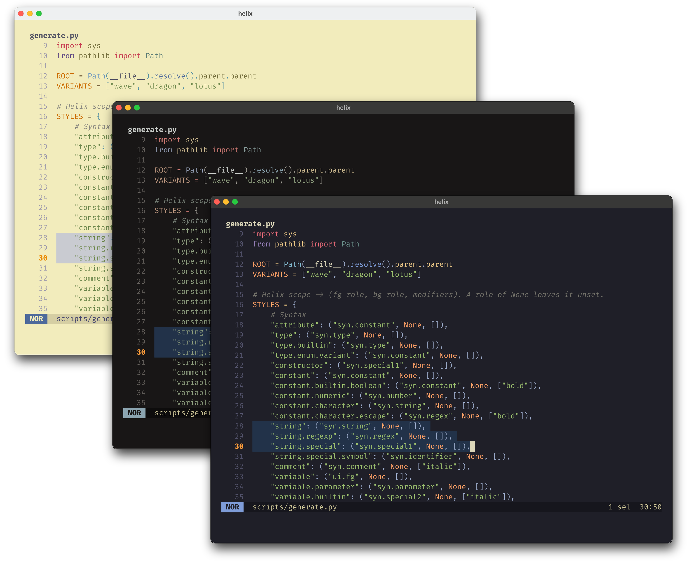
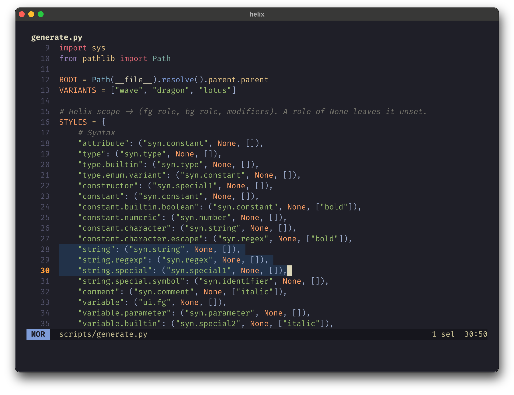
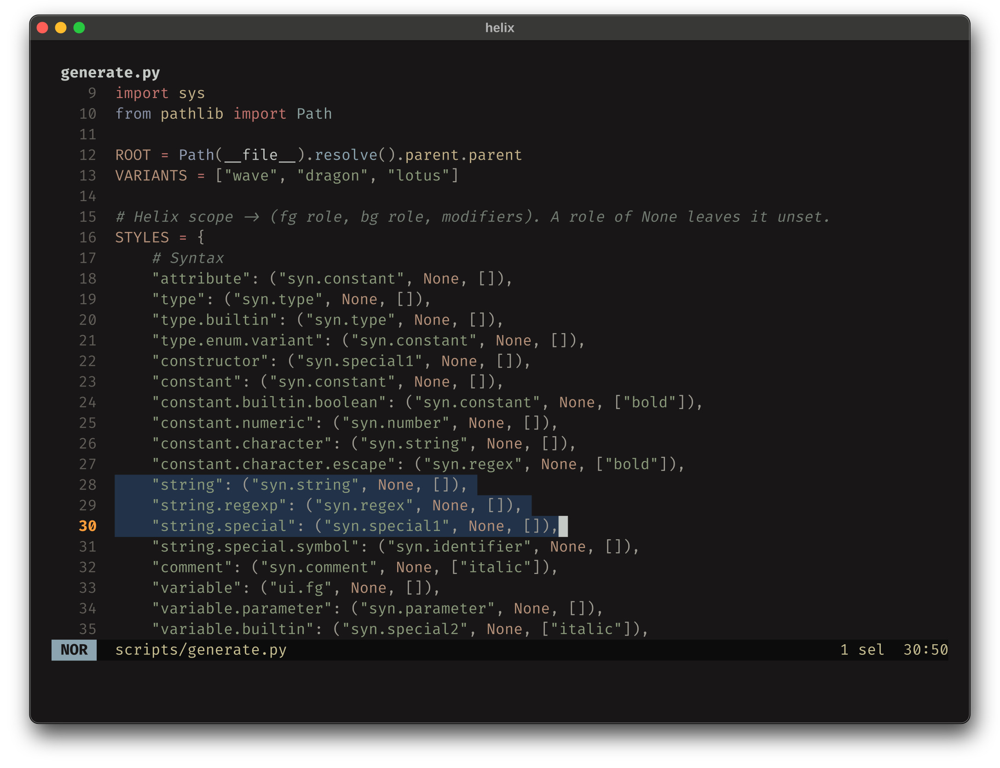
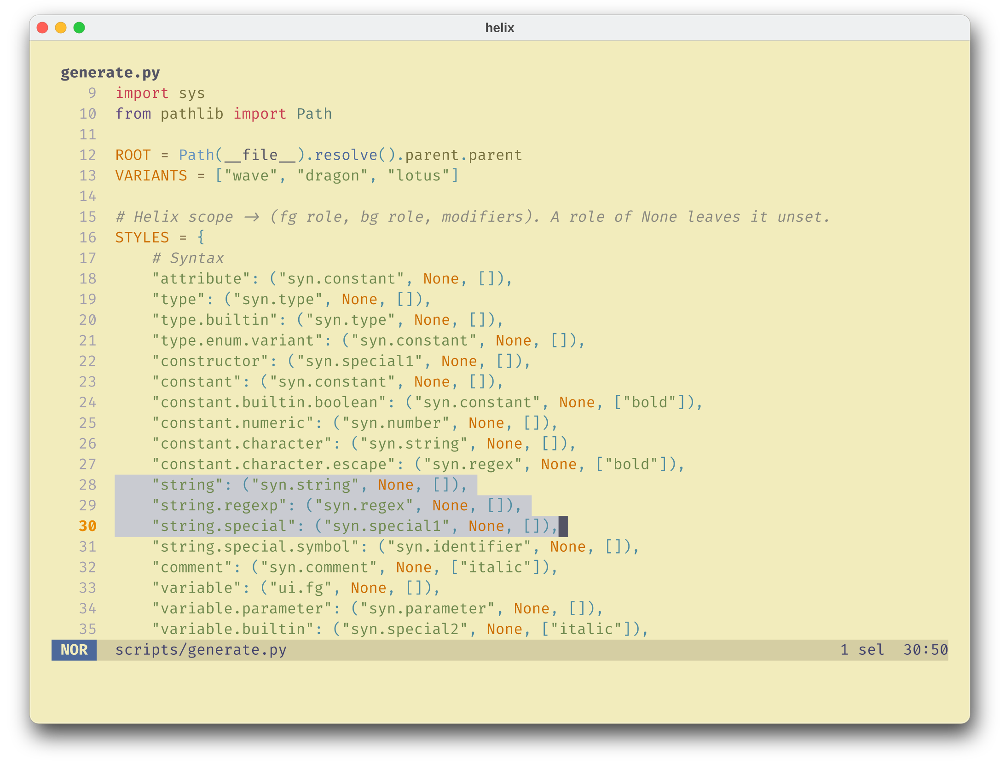

<h3>Kanagawa for <a href="https://helix-editor.com/">Helix</a></h3>
<p>A community-maintained theme inspired by Hokusai's <em>The Great Wave off Kanagawa</em>.</p>
<p>Using the <a href="https://github.com/rebelot/kanagawa.nvim">Kanagawa palette</a> by <a href="https://github.com/rebelot">Tommaso Laurenzi (rebelot)</a>.</p>

<!-- Wave accents: carpYellow, crystalBlue, autumnRed. Lotus accents: lotusYellow, lotusBlue4, lotusRed. -->
<p>
  <a href="https://github.com/kanagawa-community/helix/stargazers">
    <picture>
      <source media="(prefers-color-scheme: dark)" srcset="https://img.shields.io/github/stars/kanagawa-community/helix?style=for-the-badge&amp;labelColor=1F1F28&amp;color=E6C384">
      <source media="(prefers-color-scheme: light)" srcset="https://img.shields.io/github/stars/kanagawa-community/helix?style=for-the-badge&amp;labelColor=F2ECBC&amp;color=77713F">
      
    </picture>
  </a>
  <a href="https://github.com/kanagawa-community/helix/releases/latest">
    <picture>
      <source media="(prefers-color-scheme: dark)" srcset="https://img.shields.io/github/v/release/kanagawa-community/helix?style=for-the-badge&amp;label=release&amp;labelColor=1F1F28&amp;color=7E9CD8">
      <source media="(prefers-color-scheme: light)" srcset="https://img.shields.io/github/v/release/kanagawa-community/helix?style=for-the-badge&amp;label=release&amp;labelColor=F2ECBC&amp;color=4D699B">
      
    </picture>
  </a>
  <a href="https://github.com/kanagawa-community/helix/issues">
    <picture>
      <source media="(prefers-color-scheme: dark)" srcset="https://img.shields.io/github/issues/kanagawa-community/helix?style=for-the-badge&amp;labelColor=1F1F28&amp;color=C34043">
      <source media="(prefers-color-scheme: light)" srcset="https://img.shields.io/github/issues/kanagawa-community/helix?style=for-the-badge&amp;labelColor=F2ECBC&amp;color=C84053">
      
    </picture>
  </a>
</p>

<br clear="both">
<br>

## Previews



<details>
<summary>🌊 Wave</summary>

</details>

<details>
<summary>🐉 Dragon</summary>

</details>

<details>
<summary>🪷 Lotus</summary>

</details>

## Requirements

- Helix 23.10 or later. Tested with Helix 25.07.1.

## Installation

Download the three themes into ~/.config/helix/themes:

```sh
mkdir -p ~/.config/helix/themes
for variant in wave dragon lotus; do
  curl -fsSL -o ~/.config/helix/themes/kanagawa-$variant.toml https://raw.githubusercontent.com/kanagawa-community/helix/main/themes/kanagawa-$variant.toml
done
```

Or clone the repository and run `./install.sh`. It installs all three variants,
or only the ones you name, for example `./install.sh dragon lotus`. `./uninstall.sh`
takes the same names and removes them.

## Usage

Set the theme in `~/.config/helix/config.toml`:

```toml
theme = "kanagawa-wave"
```

Helix ships its own `kanagawa` and `kanagawa-dragon` themes. A theme in
`~/.config/helix/themes` replaces a built-in theme of the same name, so this
port's `kanagawa-dragon` is the one Helix loads. Set `color-modes = true` under
`[editor]` to color the mode in the statusline.

## Palette

Every color comes from the shared
[palette](https://github.com/kanagawa-community/.github/blob/main/docs/PALETTE.md),
picked by role, so each variant uses its own value for the same role.

| Helix color                                              | Palette role                                      |
| -------------------------------------------------------- | ------------------------------------------------- |
| `ui.background`, `ui.text`, `variable`                   | `ui.bg`, `ui.fg`                                  |
| `ui.selection`                                           | `ui.bg_visual`                                    |
| `ui.cursorline.primary`, `ui.highlight`, `ui.text.focus` | `ui.bg_p2`                                        |
| `ui.cursor`                                              | `ui.fg_dim` on `ui.bg`                            |
| `ui.linenr`, `ui.virtual`                                | `ui.nontext`                                      |
| `ui.linenr.selected`, `ui.cursor.match`                  | `diag.warning`                                    |
| `ui.statusline`, `ui.bufferline`                         | `ui.fg_dim` on `ui.bg_m3`                         |
| `ui.statusline.normal`, `.insert`, `.select`             | `ui.bg` on `syn.fun`, `syn.string`, `syn.keyword` |
| `ui.popup`, `ui.help`                                    | `ui.float.fg` on `ui.float.bg`                    |
| `ui.menu`, `ui.menu.selected`, `ui.menu.scroll`          | `ui.pmenu.*`                                      |
| `error`, `warning`, `info`, `hint`, `diagnostic.*`       | `diag.*`                                          |
| `diff.plus`, `diff.minus`, `diff.delta`                  | `vcs.added`, `vcs.removed`, `vcs.changed`         |
| syntax scopes                                            | `syn.*`                                           |

Syntax scopes take the role that the Neovim plugin uses for the same thing. `scripts/generate.py` lists every scope.

## Credits

This port replaces the Helix theme in the `extras` folder of the
[Neovim plugin](https://github.com/kanagawa-community/neovim). Antônio Camargo first contributed that theme to kanagawa.nvim. The
colors come from [kanagawa.nvim](https://github.com/rebelot/kanagawa.nvim) by
Tommaso Laurenzi.

## Issues and contributions

Report bugs and request changes in this port's
[issue tracker](https://github.com/kanagawa-community/helix/issues). Contributions are welcome.

See [CONTRIBUTING.md](CONTRIBUTING.md) before opening a pull request.

## License

MIT. See [LICENSE](LICENSE).
